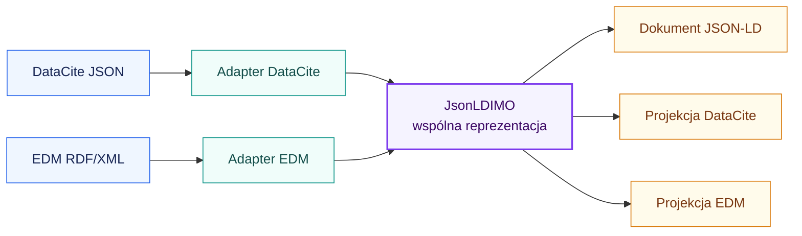
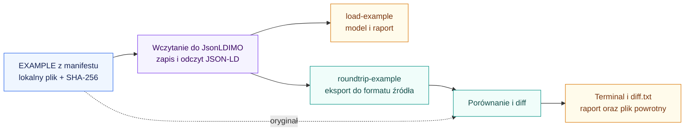
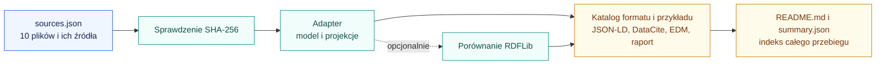

# Jak działa nasze IMO

IMO jest wspólnym modelem metadanych pomiędzy formatami wejściowymi i wyjściowymi.
Nowy wariant przechowuje JSON-LD bezpośrednio w słownikach i listach Pythona.
Adaptery DataCite i EDM przekładają dane na ten model, a następnie mogą z niego
zbudować dokument docelowy.



## Od czego zacząć

| Dokument | Co wyjaśnia |
| --- | --- |
| [Architektura](architektura.md) | Odpowiedzialności modułów, mapowania EDM i DataCite, model JSON-LD i porównanie z RDFLib |
| [EDM → JSON-LD krok po kroku](edm-jsonld.md) | Namespace’y, tytuły, identyfikatory, język, mapowanie i eksport |

Diagramy są zapisane jako bloki `mermaid`. Do ich wyświetlania potrzebny jest
podgląd Markdown obsługujący Mermaid; bez niego pozostaje czytelny kod diagramu.

## Uruchomienie

Polecenia wykonuj w katalogu głównym projektu, po instalacji zależności opisanej
w [głównym README](../README.md#run-locally).

Możesz używać zwykłego `python`, jeśli właściwe środowisko jest aktywne:

```bash
source .venv/bin/activate
```

Gotowe targety są w [Makefile](../Makefile). Nie musisz pamiętać poleceń Pythona:

| Polecenie | Co robi |
| --- | --- |
| `make help` | Pokazuje dostępne targety i zmienne |
| `make install` | Instaluje projekt i zależności testowe w wybranym środowisku |
| `make examples` | Przetwarza 10 oficjalnych wejść, porównuje z RDFLib i zapisuje indeks wyników |
| `make demo` | Przetwarza oficjalne wejścia bez porównania ze starym modelem |
| `make hierarchy` | Wypisuje przykład dataset → katalog → plik |
| `make example-datacite` | Zapisuje pojedynczy oficjalny dataset jako JSON-LD w `OUTPUT_DIR/quickstart/` |
| `make example-edm` | Zapisuje pojedynczy oficjalny rekord EDM jako JSON-LD w `OUTPUT_DIR/quickstart/` |
| `make list-examples` | Pokazuje identyfikatory wszystkich oficjalnych przykładów |
| `make load-example EXAMPLE=datacite-award` | Wczytuje wybrany przykład i zapisuje jego model JSON-LD |
| `make roundtrip-example EXAMPLE=datacite-award` | Wczytuje, eksportuje do formatu źródłowego i pokazuje różnice |
| `make rdf-demo` | Uruchamia pierwotną demonstrację RDFLib |
| `make test` | Uruchamia testy |

Domyślne `OUTPUT_DIR` to `examples/output/official-jsonld`. Interpreter i katalog
możesz wskazać jawnie, również bez aktywowania środowiska:

```bash
make examples PYTHON=.venv/bin/python OUTPUT_DIR=/tmp/imo-results
```

Konwersja własnego pliku:

```bash
make convert INPUT=examples/input/official/datacite-dataset.json FROM=datacite TO=jsonld OUTPUT=wynik.jsonld
make convert INPUT=wynik.jsonld FROM=jsonld TO=edm OUTPUT=wynik.xml
make convert INPUT=twoj-plik.xml FROM=edm SOURCE_URI=https://museum.example/original.xml OUTPUT=wynik.jsonld
```

Bez `OUTPUT` wynik trafia na stdout. Jeśli wskazujesz własny katalog w `OUTPUT`,
musi on wcześniej istnieć. Przy kilku obiektach EDM użyj `RESOURCE_ROOT`,
które jest przekazywane do `--root`. Domyślnie `FROM=datacite` i `TO=jsonld`.
Ścieżki ze spacjami ujmuj w cudzysłowy, np. `INPUT='moj plik.json'`.

### Jeden przykład: wczytanie albo konwersja powrotna z diffem

```bash
make list-examples
make load-example EXAMPLE=datacite-award
make roundtrip-example EXAMPLE=datacite-award
make roundtrip-example EXAMPLE=edm-3d-complete
```

Domyślne `EXAMPLE` to `datacite-award`, więc wystarczy też samo
`make load-example` lub `make roundtrip-example`. To odczyt lokalnego pliku,
bez wysyłania do serwera. Format i `source_uri` pochodzą z manifestu.

Wyniki trafiają do `OUTPUT_DIR/selected/EXAMPLE/`, niezależnie od wyników
zbiorczych. Samo wczytanie zapisuje `imo.jsonld`, `report.json` i `README.md`.
Round trip dodatkowo zapisuje `roundtrip.datacite.json` albo `roundtrip.edm.xml`
oraz `diff.txt`. Dla DataCite powstaje też `source-metadata.json` z porównywanym
zakresem źródła. Diff pokazuje usunięcia (`-`) i dodania (`+`) w terminalu.



W DataCite porównujemy metadane, pomijając kopertę API i pola techniczne, np.
statystyki oraz zakodowany XML. W EDM porównujemy stwierdzenia RDF, pomijając
różnice prefiksów i formatowania XML. Backup nie jest używany do odtwarzania
wyniku. Różnice są wynikiem pomiaru, więc same w sobie nie powodują błędu
polecenia; błąd odczytu lub nieznany identyfikator już tak. Ponowne samo
wczytanie usuwa poprzednie wygenerowane pliki round trip dla wybranego przypadku.

Równoważne polecenia Pythona:

```bash
python demo_json.py --case datacite-award --load-only
python demo_json.py --case datacite-award --show-diff
```

`make examples` nadal uruchamia cały zestaw i dodatkowo porównuje starą
implementację. `roundtrip-example` sprawdza nowy model bez jej uruchamiania.

### Bezpośrednie polecenia Pythona

Poniżej pozostałe operacje bezpośrednio przez Pythona.

Oficjalne przykłady i porównanie obu implementacji:

```bash
python demo_json.py --compare-rdf
```

Pojedynczy plik DataCite → JSON-LD:

```bash
python -m imo.json_adapters \
  examples/input/official/datacite-dataset.json \
  --from datacite -o wynik.jsonld
```

JSON-LD → EDM:

```bash
python -m imo.json_adapters \
  wynik.jsonld --from jsonld --to edm -o wynik.xml
```

EDM → JSON-LD, z oryginalnym adresem pliku używanym jako bazowy:

```bash
python -m imo.json_adapters \
  examples/input/official/edm.xml --from edm \
  --source-uri https://raw.githubusercontent.com/europeana/contrib/master/ntua/mint2/src/main/webapp/schemas/edm/EDM.xml \
  -o edm-wynik.jsonld
```

`--to` przyjmuje `jsonld`, `datacite` lub `edm`; domyślnie jest to `jsonld`.
Bez `-o` program wypisuje wynik na standardowe wyjście. `--source-uri` nie
powoduje pobierania dokumentu. Obecny CLI wymaga tego parametru dla każdego
wejścia EDM, również gdy sam XML zawiera `xml:base` lub pełne identyfikatory.

## Podstawowe pojęcia

| Pojęcie | Znaczenie w projekcie |
| --- | --- |
| XML | Składnia dokumentu: elementy, atrybuty, przestrzenie nazw |
| RDF | Model danych: zasoby, właściwości i wartości lub relacje |
| RDF/XML | Zapis RDF w XML; wejście adaptera EDM |
| EDM | Model Europeany, korzystający też z DC, DCT i ORE |
| Słownik / vocabulary | Nazwy o określonym znaczeniu, identyfikowane przez URI |
| JSON-LD | Zapis danych RDF w JSON, z kontekstem określającym znaczenie pól |
| `JsonLDIMO` | Nasz obiekt Pythona przechowujący zasoby, root, pochodzenie i backup |
| Projekcja | Dokument docelowy zbudowany z obsługiwanych danych wspólnego modelu |
| Round trip | Wejście → model → ten sam format; sprawdzamy, co zostało zachowane |

## Katalog przykładów i wyników

Mamy **10 oficjalnych plików wejściowych: 6 DataCite i 4 EDM**. Katalog
[źródeł](../examples/input/official/README.md) opisuje każdy przypadek, a
[sources.json](../examples/input/official/sources.json) zawiera oryginalne
adresy, daty pobrania i sumy kontrolne. Nowe rekordy EDM pochodzą z repozytorium
Europeany w konkretnej, zapisanej rewizji.

Pliki JSON są sformatowane z wcięciem dwóch spacji i czytelnymi znakami UTF-8.
Wartości oraz kolejność kluczy i elementów tablic pozostają bez zmian.
`sha256` dotyczy lokalnego, sformatowanego pliku, a `downloadSha256` zachowuje
sumę oryginalnego pobranego JSON-a. Daty pobrania pozostają takie jak wcześniej.

| Format | Przykłady |
| --- | --- |
| DataCite | Pełny rekord, dataset, grant, projekt, metadane wielojęzyczne, artykuł z RelatedItem czasopisma |
| EDM | Instrument muzyczny, obraz, dźwięk, rozbudowany obiekt 3D |

Wejdź do [indeksu wyników](../examples/output/official-jsonld/README.md).
Każdy przykład ma własny katalog pod `datacite/` lub `edm/`, z plikiem
`README.md`, modelem `imo.jsonld`, obiema projekcjami i `report.json`.
`summary.json` zawiera zbiorcze wyniki i ścieżki do plików. Opcja
`--compare-rdf` dodaje model oryginalnej implementacji, jeśli udało się go
zbudować. Błąd starego adaptera jest raportowany oddzielnie.

Możesz wskazać własny katalog wyników:

```bash
python demo_json.py --compare-rdf --output-dir /tmp/imo-results
```



## Co sprawdziliśmy

Wszystkie nowe wejścia parsują się do `JsonLDIMO`. To nie oznacza, że
konwersja powrotna jest bezstratna. Niezależne porównanie RDF/XML pokazuje:

| Wejście EDM | Trójki źródłowe | Zachowane | Utracone | Dodane |
| --- | ---: | ---: | ---: | ---: |
| Instrument muzyczny | 29 | 29 | 0 | 0 |
| Obraz Tier 1 | 19 | 13 | 6 | 2 |
| Dźwięk Tier 1 | 18 | 13 | 5 | 2 |
| Pełny obiekt 3D | 106 | 56 | 50 | 2 |

Zachowanie 29 trójek pierwszego przykładu oznacza równoważność grafów RDF,
a nie identyczny tekst XML. Bogatsze przykłady ujawniają nieobsługiwane
właściwości, klasy i relacje oraz utratę języka nazw autorów. Tworzone przez
adapter węzły autorów mogą dodawać stwierdzenia. Raport rozróżnia trójki
zachowane, utracone i dodane, zamiast porównywać tylko długości grafów.

W DataCite powrót jest częściowy. Grant ma identyfikator autora bez wartości;
nowy adapter zapisuje ostrzeżenie i zachowuje oryginał w backupie. Stary adapter
nie przetwarza grantu i projektu; błąd porównania nie przerywa reszty przebiegu.
Żaden z nowych eksporterów nie odtwarza backupu, aby ukryć straty mapowania.

Konwersje między EDM a DataCite są szkicami. Nie przeszły pełnej walidacji
schematów docelowych. Zakres obsługi opisuje
[architektura](architektura.md#zakres-i-straty-konwersji).
