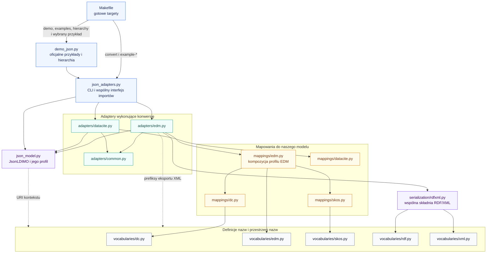
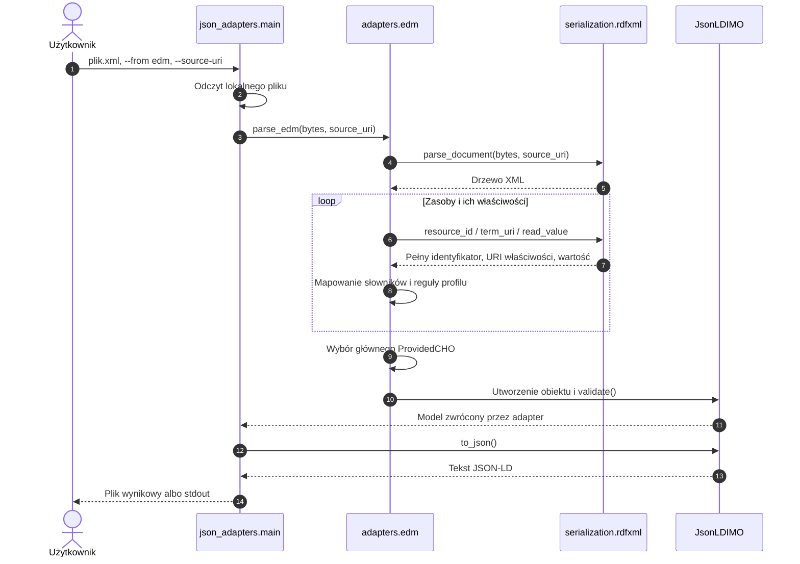
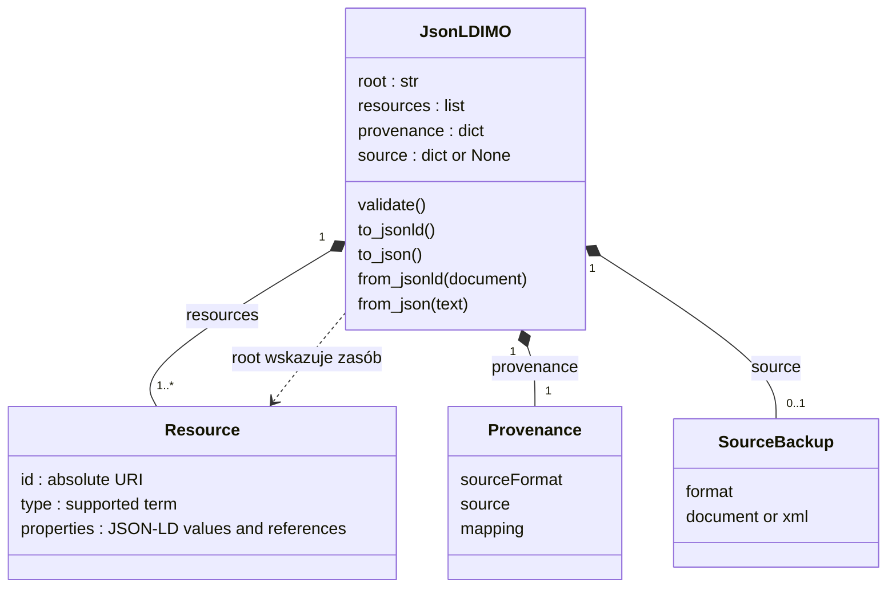
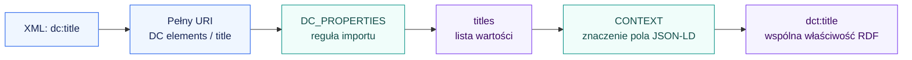
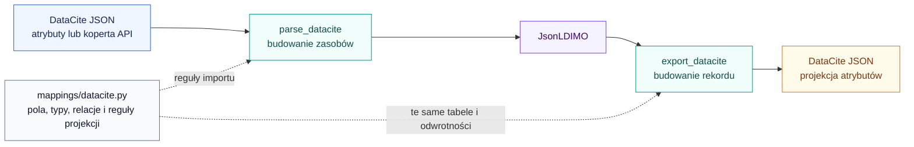

# Architektura konwersji metadanych

[Dokumentacja](README.md) · [Przykład EDM → JSON-LD](edm-jsonld.md)

## Podział odpowiedzialności

Rozdzielamy definicje nazw, obsługę składni pliku, reguły konkretnego formatu
i wspólny model. Dzięki temu przyszły adapter może ponownie wykorzystać
obsługę RDF/XML lub mapowania DC bez importowania adaptera EDM.

Strzałka na diagramie oznacza **„korzysta z”**. To diagram zależności
architektonicznych, a nie kolejności wykonywania funkcji.



| Moduł | Odpowiedzialność | Przykład |
| --- | --- | --- |
| [Makefile](../Makefile) | Gotowe polecenia wywołujące istniejące programy Pythona | `make examples`, `make convert`, `make test` |
| [vocabularies/dc.py](../imo/vocabularies/dc.py) | Definicje nazw DC/DCT | `TITLE` → pełny URI `dc:title` |
| [vocabularies/edm.py](../imo/vocabularies/edm.py) | Własne terminy EDM i agregacje ORE | `edm:ProvidedCHO`, `edm:isShownBy` |
| [vocabularies/skos.py](../imo/vocabularies/skos.py) | Definicje nazw SKOS | URI `skos:Concept`, `skos:prefLabel` |
| [vocabularies/rdf.py](../imo/vocabularies/rdf.py) | Nazwy składni RDF/XML | `ABOUT`, `RESOURCE`, `DATATYPE` |
| [vocabularies/xml.py](../imo/vocabularies/xml.py) | Standardowe nazwy atrybutów XML | `BASE`, `LANG`, `SPACE`, `ID` |
| [mappings/dc.py](../imo/mappings/dc.py) | Reguły normalizacji DC/DCT | URI `dc:title` → klucz `titles` |
| [mappings/skos.py](../imo/mappings/skos.py) | Reguły normalizacji SKOS | `skos:prefLabel` → `labels` |
| [mappings/edm.py](../imo/mappings/edm.py) | Mapowania natywne EDM/ORE i kompozycja profilu z DC/DCT i SKOS | `EDM_PROPERTIES`, `EDM_TYPES` |
| [mappings/datacite.py](../imo/mappings/datacite.py) | Deklaratywne reguły DataCite JSON w obu kierunkach | Typy zasobów, listy tekstowe, rodzaje opisów i relacje |
| [serialization/rdfxml.py](../imo/serialization/rdfxml.py) | Odczyt/zapis obsługiwanej składni | `rdf:resource` → obiekt `@id` |
| [adapters/edm.py](../imo/adapters/edm.py) | Wykonanie reguł profilu, budowanie zasobów i wybór root | Wybór `ProvidedCHO` |
| [adapters/datacite.py](../imo/adapters/datacite.py) | Odczyt struktury DataCite, budowanie zasobów i konwersje wartości według mapowań | `creators` → zasoby autorów |
| [json_model.py](../imo/json_model.py) | Profil, walidacja i serializacja JSON-LD | `validate()`, `to_jsonld()` |
| [json_adapters.py](../imo/json_adapters.py) | CLI i dotychczasowy interfejs funkcji | `python -m imo.json_adapters` |

Słowniki i moduły `mappings` są zwykłymi modułami Pythona, bez zależności od
parsera i modelu. `vocabularies` definiuje wyłącznie nazwy i przestrzenie nazw.
Wszystkie reguły przejścia z terminów RDF lub pól DataCite do naszego modelu
znajdują się w `mappings`. Moduły mapowań importują definicje nazw; słowniki
nie importują mapowań.

Kompozycja DC/DCT + EDM/ORE + SKOS należy do `mappings/edm.py`. Adapter EDM
importuje gotowe `EDM_PROPERTIES`, `EDM_TYPES` oraz reguły kształtu wartości.
Natomiast `CONTEXT` w `json_model.py` nadal definiuje znaczenie i profil
wspólnego dokumentu JSON-LD; nie jest mapowaniem konkretnego formatu wejściowego.

Warstwa `rdfxml` korzysta z lxml oraz definicji RDF/XML. Nie importuje EDM, DC,
DataCite ani `JsonLDIMO`. Model JSON-LD używa wyłącznie biblioteki standardowej.

Bezpośredni import `imo.adapters.datacite` nie ładuje lxml ani RDFLib.
Wspólny moduł `json_adapters.py` importuje oba adaptery, więc ładuje także
warstwę XML. Żaden z nowych adapterów nie wymaga RDFLib.

## Przepływ pojedynczej konwersji

`Makefile` nie implementuje konwersji. Domyślnie uruchamia `python` z `PATH`;
`PYTHON` pozwala wskazać inny interpreter. `make convert` przekazuje parametry
do istniejącego CLI, a `make examples` uruchamia `demo_json.py --compare-rdf`.
`make load-example` i `make roundtrip-example` wybierają jeden rekord przez
`demo_json.py --case`. Pierwszy zapisuje model po wczytaniu, drugi wykonuje
eksport do formatu źródłowego i wypisuje diff. `make list-examples` odczytuje
identyfikatory z manifestu, bez parsowania rekordów.
Target `test` wywołuje pytest, a `rdf-demo` pierwotne `demo.py`. Zmienne
`INPUT`, `OUTPUT` i pozostałe argumenty są przekazywane przez środowisko
i cytowane w powłoce, aby ścieżki ze spacjami nie rozbijały argumentów.

Poniżej pokazano uruchomienie CLI dla EDM → JSON-LD. Wybór formatu i zapis
pliku należą do CLI; interpretacja metadanych należy do adaptera.



CLI konwertuje bezpośrednio w pamięci. Demonstracja `demo_json.py` dodatkowo
wykonuje zapis JSON-LD i ponowny odczyt przed eksportem, aby sprawdzić również
granicę serializacji.

## Jak wygląda wspólny model

`JsonLDIMO` ma cztery pola. Zasoby są już zapisane w formie obiektów JSON-LD,
więc kod pracuje bezpośrednio na listach i słownikach.



Na diagramie `Resource`, `Provenance` i `SourceBackup` to pojęcia dokumentacyjne,
a nie dodatkowe klasy Pythona. W zasobie rzeczywiste klucze to `@id` i `@type`.
`provenance` ma elastyczną strukturę; adapter EDM dodaje tam również raport
mapowania. Adapter DataCite dodaje `warnings`, jeśli identyfikator autora ma
schemat, ale nie ma wartości; wskazuje pozycję JSON i zachowuje oryginał w backupie. Metoda `validate()` nie wymaga tych konkretnych kluczy pochodzenia.

Przy `to_jsonld()` pola są pakowane w rekord:

| Obiekt Pythona | Zapis dokumentu |
| --- | --- |
| `root` | `root: {"@id": "..."}` |
| `resources` | `@graph: [...]` |
| `provenance` | Pole `provenance`, mapowane w kontekście jako `@json` |
| `source` | Opcjonalne pole `source`, również jako `@json` |
| Stała `CONTEXT` | `@context` z lokalnie zdefiniowanymi terminami |

Rekord ma `@id: "urn:imo:record"`, `@type: "imo:Record"` i
`modelVersion: "1.0"`. Jego `@graph` jest nazwanym grafem zasobów. To inny układ
niż trzy grafy występujące w oryginalnym modelu RDFLib.

`root` jest wskaźnikiem głównego opisywanego zasobu, a nie adresem bazowym XML.
Musi występować w `resources`. Odwołania do innych zasobów mogą prowadzić poza
ten dokument.

## Dwa różne mapowania

Pierwsze mapowanie określa reguły importu. Drugie nadaje znaczenie polom JSON-LD.
Wspólny klucz `titles` łączy te etapy, ale jego nazwa jest naszą konwencją.



Nie następuje automatyczne uznanie `dc:title` i `dct:title` za tę samą
właściwość. To adapter jawnie normalizuje obsługiwany tytuł źródłowy do wybranej
właściwości wspólnej. Sam kontekst nie uruchamia parsera EDM i nie sprawia,
że dowolny termin z zadeklarowanej przestrzeni staje się obsługiwany.

## Mapowania DataCite

DataCite JSON nie używa deklaracji `xmlns`. Jego klucze i wartości kontrolowane
mapujemy przez [mappings/datacite.py](../imo/mappings/datacite.py). Adapter
[adapters/datacite.py](../imo/adapters/datacite.py) importuje te tabele zarówno
przy parsowaniu, jak i przy eksporcie. Odwrotne mapowania typów autorów
i rodzajów opisów są wyprowadzane z tabel wejściowych.



| Tabela | Reguła |
| --- | --- |
| `RESOURCE_TYPE_MAP` | `Dataset` → `Dataset`, `Collection` → `Collection`; pozostałe mają wspólny typ `CreativeWork` |
| `AGENT_TYPE_MAP` / `AGENT_FIELDS` | Typ osoby/organizacji oraz pola imienia i nazwiska |
| `TYPE_FIELDS` | Pola klasyfikacji źródłowej z obiektu `types` |
| `SCALAR_FIELDS` | Proste pola `language` i `version` |
| `TEXT_FIELDS` | Dla list `titles`, `subjects`, `dates`: pole modelu, klucz tekstu, opcjonalny klucz języka |
| `DESCRIPTION_TYPE_MAP` | `Abstract` → `abstracts`, `Other` → `descriptions` |
| `RELATION_MAP` | Obsługiwane relacje, np. `HasPart` → `hasPart` |
| `TEXT_QUALIFIER_EXCLUSIONS` | Pomijanie tytułów z `titleType` w normalizacji tytułów |
| `TEXT_EXPORT_DEFAULTS` | Eksport dat bez zachowanego rodzaju jako `dateType: Other` |
| `IDENTIFIER_PREFIXES` | Rozwinięcie identyfikatora DOI do adresu HTTPS |
| `REQUIRED_FIELDS` | Sześć pól sprawdzanych przez minimalną kontrolę kompletności |

Przykładowy wpis tabeli tekstowej:

```python
TEXT_FIELDS = {
    "titles": ("titles", "title", "lang"),
}
```

Oznacza to odczyt listy źródłowej `titles`, pobranie tekstu z `title` i języka
z `lang`, a następnie zapis wartości pod polem modelu `titles`. Ta sama reguła
pozwala eksporterowi odbudować tekst i język tytułów.

Tworzenie identyfikatorów zasobów, rozpakowanie `data.attributes`, budowanie
autorów i wydawcy oraz konwersja roku na tekst i z powrotem nadal należą do
adaptera. Tabela nazw nie zastępuje tych operacji. Wydzielenie mapowań nie
zwiększa pokrycia DataCite i nie usuwa opisanych niżej strat.

## Wariant bezpośredni i wariant RDFLib

Obie implementacje zapisują dane jako JSON-LD i opisują dane RDF. Różnią się
strukturami w pamięci, profilem dokumentu i zakresem adapterów.

| Cecha | Bezpośredni JSON-LD | Oryginalny RDFLib |
| --- | --- | --- |
| Model | `imo/json_model.py`, `JsonLDIMO` | `imo/rdf_model.py`, `IMO` |
| Dane w pamięci | Listy i słowniki | Obiekty `Graph` |
| Adaptery | `imo/adapters/` | `imo/parsers/` i `imo/converters/` |
| Warstwy danych | Zasoby + JSON pochodzenia i backupu | Graf wspólny, natywny i pochodzenia |
| Odtworzenie źródła | Brak eksportu odtwarzającego backup | `preserve=True`, residuals lub natywny graf |
| Kontrola zmiany przed odtworzeniem | Nie dotyczy: eksporter nie odtwarza backupu | `seal()` i `assert_fresh()` |
| Pełna obsługa dowolnego JSON-LD | Nie | Nie |

Dokumentu jednej implementacji nie należy przekazywać do czytnika drugiej.
Obie wymagają swojego konkretnego kontekstu i układu. Oryginalny
[rdf_model.py](../imo/rdf_model.py) pozostaje punktem porównania.

Publiczne nazwy modeli to `from imo import JsonLDIMO` i `from imo import IMO`.
Alias `JsonIMO` po dawnym prototypie zwykłego JSON został usunięty; nie ma
trzeciej implementacji modelu. `main.py` pozostaje punktem uruchomienia
oryginalnego demo w IDE, a `json_adapters.py` wspólnym API i CLI nowych adapterów.

## Zakres i straty konwersji

Nowy model waliduje strukturę własnego profilu: kontekst, obsługiwane pola,
typy wartości, unikalność identyfikatorów i obecność root. To nie jest pełna
walidacja DataCite ani Europeany. Identyfikatory zasobów w tym profilu mogą
być adresami HTTP(S) lub URN.

Warstwa RDF/XML obsługuje płaskie, nazwane zasoby. Odrzuca DTD i obsługiwaną
ścieżką wykryte konstrukcje zagnieżdżone/anonimowe. Potrafi odczytać literal
z `rdf:datatype`; adapter EDM nadal raportuje taki literal jako nieobsługiwany.
Zdefiniowanie `xml:space` i `xml:id` w module słownika nie oznacza ich obsługi
przez bieżący profil adaptera.

Przy eksporcie używamy danych z `resources`. Backup `source` nie uzupełnia
projekcji. Dlatego można zobaczyć realne straty mapowania, nawet gdy oryginalny
dokument nadal znajduje się w rekordzie jako oznaczona kopia.

| Kierunek | Istotne ograniczenie |
| --- | --- |
| DataCite → DataCite | Częściowo tracone są m.in. typowane tytuły, afiliacje, schematy identyfikatorów, role dat i finansowanie |
| EDM → DataCite | Projekcja dotyczy głównego CHO; nie przenosi licencji zdjęcia na fizyczny obiekt |
| DataCite → EDM | Powstaje widok CHO; nie są tworzone fikcyjne WebResource i Aggregation |
| EDM → EDM | Instrument zachowuje 29/29 trójek; nowe przykłady obrazu, dźwięku i 3D pokazują realne straty i dodane stwierdzenia |

Funkcja `missing_datacite_fields()` sprawdza tylko obecność sześciu pól
najwyższego poziomu. Pusty raport braków nie oznacza pełnej zgodności ze schematem.
Porównanie pokrycia starych i nowych adapterów opisują
[indeks raportów przykładów](../examples/output/official-jsonld/README.md).

## Jak dodać nowy format

1. Ustal składnię wejścia: RDF/XML może użyć `serialization/rdfxml.py`;
   inny format dostaje własną obsługę składni.
2. Zdefiniuj nazwy w `vocabularies/`, a reguły przejścia do naszego modelu
   w `mappings/`, niezależnie od składni źródła. Wspólne reguły DC wykorzystaj
   z `mappings/dc.py`, bez importowania adaptera EDM. Jeśli format łączy kilka
   słowników, skomponuj profil w jego module mapowań, jak w `mappings/edm.py`.
3. Dodaj adapter budujący `JsonLDIMO`, z jawnymi regułami wyboru root i strat.
4. Jeśli potrzeba nowych pól wspólnych, rozszerz też `CONTEXT` i walidację
   w `json_model.py`. Samo dodanie mapowania wejścia nie wystarczy.
5. Dodaj eksporter i reprezentatywny przykład, a następnie sprawdź znaczenie
   wyniku niezależnie od nowego kodu mapowania.

Obsługa DC/OAI-DC jako osobnego formatu nie jest jeszcze zaimplementowana.
Wspólne mapowania DC stanowią część potrzebnej logiki, ale struktura dokumentu
i zasady wyboru zasobu wymagają oddzielnego adaptera.

## Organizacja eksperymentów

`demo_json.py` odczytuje manifest 10 oficjalnych wejść, sprawdza ich SHA-256
oraz zapisuje każdą konwersję pod ścieżką `format/id-przykładu/` w katalogu
wyników. Dla każdego przypadku tworzy model JSON-LD, obie projekcje, raport
oraz lokalny indeks Markdown. Zbiorczy `README.md` i `summary.json` wskazują
pliki wynikowe; ścieżki w raportach są względne wobec katalogu wyników.

`--output-dir` pozwala zmienić katalog. `--compare-rdf` uruchamia dodatkowo
historyczne adaptery i niezależne porównanie grafów. `_compare_original()`
wydziela tę dodatkową operację; jej błąd trafia do `rdfComparison` i nie
usuwa pomyślnych wyników nowego adaptera ani nie przerywa następnych przykładów.
To nie jest pomyślny round trip: `status: error` jawnie informuje o błędzie
starej implementacji. Niewłaściwa suma kontrolna źródła przerywa przebieg.

Przykłady, ich licencje i zmierzone wyniki są opisane w
[katalogu wejść](../examples/input/official/README.md) oraz
[indeksie wyników](../examples/output/official-jsonld/README.md).

`run_example()` obsługuje pojedyncze wejście wskazane przez `--case`.
`official_sources()` i `_load_official_model()` współdzielą z przebiegiem
zbiorczym odczyt manifestu, kontrolę SHA-256 i wybór parsera. Wyniki pojedynczego
eksperymentu są pod `selected/id/`, więc nie zastępują zbiorczego indeksu
ani raportu tego samego rekordu w katalogu formatu.

W trybie round trip `run_example()` porównuje wyłącznie projekcję nowego modelu
z wejściem: DataCite jako struktury metadanych JSON, EDM jako grafy RDF przez
niezależny RDFLib. Ta operacja nie wywołuje historycznych adapterów.
Diff JSON jest tekstowym widokiem uporządkowanych kluczy obu struktur,
a diff RDF listą utraconych i dodanych stwierdzeń. `report.json` określa zakres
porównania i pole `equal`; wynik nie oznacza pełnej walidacji schematu.
