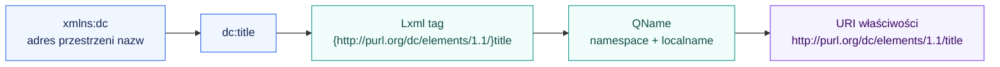
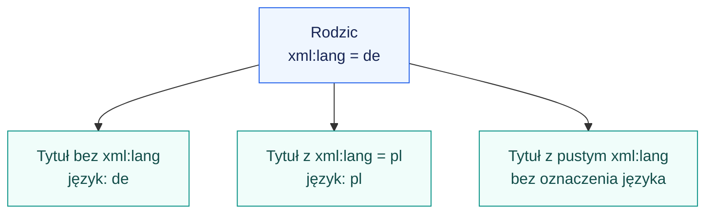
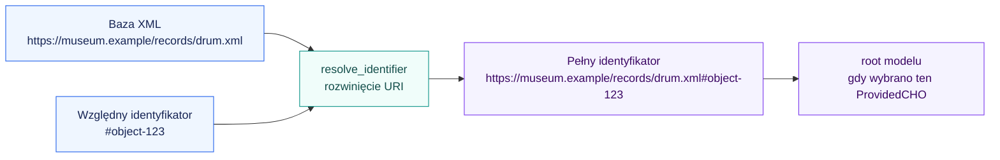
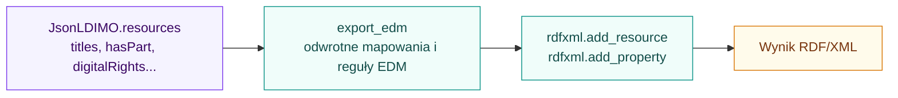
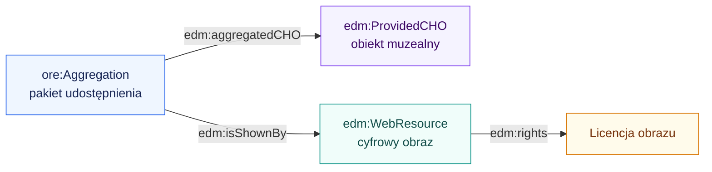

# EDM → JSON-LD krok po kroku

[Dokumentacja](README.md) · [Architektura](architektura.md)

Prześledźmy jeden zasób od znacznika XML do pola w naszym modelu i z powrotem.
Poniższy XML jest małym przykładem objaśniającym. Dodaje jawny adres bazowy
i język; oryginalny oficjalny plik jest osobno w
[examples/input/official/edm.xml](../examples/input/official/edm.xml).

## 1. Dokument wejściowy

```xml
<rdf:RDF
    xmlns:rdf="http://www.w3.org/1999/02/22-rdf-syntax-ns#"
    xmlns:edm="http://www.europeana.eu/schemas/edm/"
    xmlns:dc="http://purl.org/dc/elements/1.1/"
    xml:base="https://museum.example/records/drum.xml"
    xml:lang="de">
  <edm:ProvidedCHO rdf:about="#object-123">
    <dc:title>kleine Pauke</dc:title>
    <dc:title>Kesselpäuklein</dc:title>
  </edm:ProvidedCHO>
</rdf:RDF>
```

| Część zapisu | Co oznacza |
| --- | --- |
| `xmlns:dc="..."` | Deklaracja przypisująca prefiks do przestrzeni nazw |
| `<dc:title>...</dc:title>` | Element zawierający tytuł |
| `rdf:about="#object-123"` | Atrybut wskazujący opisywany zasób |
| `xml:lang="de"` | Atrybut określający język treści w swoim zakresie |
| `xml:base="..."` | Atrybut określający bazę dla względnych adresów |

Dwa elementy `dc:title` opisują dwa tytuły tego samego obiektu. Drugi nie
nadpisuje pierwszego. Ten zapis nie ustala, który tytuł jest główny.

## 2. Prefiks jest skrótem, URI nadaje tożsamość

Lxml rozpoznaje deklaracje `xmlns` i przechowuje nazwę elementu w postaci
`{przestrzeń}nazwa`. Funkcja `rdfxml.term_uri()` używa `etree.QName`, aby odczytać
te dwie części i zbudować pełny URI właściwości.



Można użyć prefiksu `opis:title` zamiast `dc:title`, jeśli `opis` wskazuje
tę samą przestrzeń. Parser dostanie ten sam pełny URI. Samo słowo `title`
nie wystarcza do rozpoznania właściwości.

| Prefiks | Rola w tym projekcie |
| --- | --- |
| `rdf` | Składnia opisu zasobów: `about`, `resource`, `datatype` |
| `xml` | Język i adres bazowy; prefiks zarezerwowany przez XML |
| `dc` | Podstawowe metadane Dublin Core, np. `title` i `creator` |
| `dcterms` / `dct` | Dublin Core Terms, np. `hasPart`, `created` i `title` |
| `edm` | Obiekty i relacje Europeany |
| `ore` | Agregacje zasobów |
| `skos` | Pojęcia, preferowane i alternatywne etykiety |
| `xsi` | Informacje o schemacie XML; nasz parser nie wykonuje na tej podstawie walidacji XSD |

Adres przestrzeni nazw jest identyfikatorem. Jego wystąpienie w `xmlns`
nie uruchamia pobierania definicji z internetu.

## 3. Odczyt wartości to zadanie warstwy RDF/XML

W [serialization/rdfxml.py](../imo/serialization/rdfxml.py) nazwy atrybutów
pochodzą z modułów `vocabularies/rdf.py` i `vocabularies/xml.py`.

| Konstrukcja RDF/XML | Wynik wspólnej warstwy |
| --- | --- |
| `rdf:about="#object-123"` | `resource_id()` zwraca rozwinięty identyfikator zasobu |
| Zwykła treść elementu | `read_value()` zwraca `{"@value": "treść"}` |
| `xml:lang="de"` w zakresie wartości | Do literału dodawane jest `"@language": "de"` |
| `rdf:resource="adres"` | Wartość jest referencją `{"@id": "pełny adres"}` |
| `rdf:datatype="URI typu"` | Literał otrzymuje `@type`; nie dziedziczy języka |

Dla pierwszego tytułu z przykładu wynik `read_value()` to:

```json
{"@value": "kleine Pauke", "@language": "de"}
```

Warstwa nie zna znaczenia „tytułu”. Taki sam odczyt wartości działa dla
właściwości z innego słownika. Odpowiada za składnię i zakres atrybutów.

### Język jest dziedziczony

`xml:lang="de"` na `rdf:RDF` obejmuje tytuły wewnątrz dokumentu. Najbliższe
ustawienie języka wygrywa, a `xml:lang=""` anuluje język odziedziczony.



### Adres bazowy i root to różne rzeczy

`#object-123` jest identyfikatorem względnym. Bazę wyznacza `xml:base` w zakresie
elementu, a gdy go nie ma — adres dokumentu przekazany jako `source_uri`.
Lxml uwzględnia też względne i zagnieżdżone deklaracje `xml:base`.



Inny fragment, np. `#image-456`, da inny zasób przy tej samej bazie.
Adres absolutny, np. `https://museum.example/objects/123`, nie potrzebuje
uzupełnienia bazą. Baza XML nie jest wyznaczana przez `xmlns:edm` ani `xmlns:dc`.

Jeśli mamy wyłącznie lokalną kopię bez `xml:base` i nie znamy oryginalnego
adresu, nie odtworzymy jednoznacznie pełnych identyfikatorów względnych.
Możemy przyjąć własną bazę, ale zmieni to tożsamość wskazywanych zasobów.

## 4. Adapter EDM wybiera pole naszego modelu

W [vocabularies/dc.py](../imo/vocabularies/dc.py) zdefiniowano pełną nazwę
`TITLE`. Reguła konwersji jest osobno, w [mappings/dc.py](../imo/mappings/dc.py):

```python
from imo.vocabularies import dc

DC_PROPERTIES = {
    dc.TITLE: "titles",
    # pozostałe obsługiwane właściwości
}
```

Profil [mappings/edm.py](../imo/mappings/edm.py) składa te reguły z DCT,
własnymi mapowaniami EDM i mapowaniami SKOS. Adapter
[adapters/edm.py](../imo/adapters/edm.py) importuje gotowy profil. Dla każdej
właściwości ustala docelowy klucz i dopisuje wartość według reguł danego pola.

Po odczycie obu tytułów fragment `model.resources[0]` wygląda tak:

```json
{
  "@id": "https://museum.example/records/drum.xml#object-123",
  "@type": "ProvidedCHO",
  "titles": [
    {"@value": "kleine Pauke", "@language": "de"},
    {"@value": "Kesselpäuklein", "@language": "de"}
  ]
}
```

`titles` jest naszą nazwą pola listowego. JSON-LD pozwalałby też użyć
nazwy `title` z listą wartości; liczba mnoga nie jest wymogiem standardu.

Kod zachowuje strukturę listy, ale kontekst definiuje `titles` jako `@set`.
Znaczenie RDF nie obejmuje więc kolejności ani powtórzeń identycznego tytułu.

## 5. Kontekst określa znaczenie pól

W [json_model.py](../imo/json_model.py) pełny kontekst zawiera m.in.:

```json
{
  "dct": "http://purl.org/dc/terms/",
  "edm": "http://www.europeana.eu/schemas/edm/",
  "ProvidedCHO": "edm:ProvidedCHO",
  "titles": {"@id": "dct:title", "@container": "@set"}
}
```

To **fragment kontekstu do objaśnienia**, a nie kompletny dokument wejściowy
naszego czytnika. `from_jsonld()` wymaga dokładnie całego kontekstu projektu,
który `to_jsonld()` dołącza automatycznie.

Kontekst oznacza, że `titles` opisuje właściwość o URI
`http://purl.org/dc/terms/title`. Nasze reguły importu świadomie przeniosły
tytuły z `dc:title` do tej wspólnej właściwości.

Po zbudowaniu zasobów adapter wybiera `root`: pojedynczy `ProvidedCHO` jest
wybierany automatycznie; przy wielu trzeba podać jego pełny identyfikator.
Inne zasoby pozostają w `resources`. Następnie model jest walidowany i może
zostać zapisany jako dokument JSON-LD.

## 6. Eksport do EDM odwraca obsługiwane mapowania

Eksporter EDM dobiera docelowe typy i właściwości, a wspólna warstwa RDF/XML
zapisuje elementy, referencje oraz literały z językiem lub typem.



Dla przykładowych tytułów powstają elementy `dc:title` z `xml:lang="de"`.
Eksport zapisuje pełne identyfikatory. Nie musi odtwarzać oryginalnych prefiksów,
względnych ścieżek, wcięć, komentarzy ani kolejności wszystkich stwierdzeń.
Sprawdzamy znaczenie danych, a nie identyczność tekstu pliku.

## 7. Obiekt fizyczny, obraz i agregacja pozostają oddzielne

Oficjalny przykład zawiera trzy podstawowe role EDM oraz dodatkowe zasoby
kontekstowe. Poniższy diagram pokazuje uproszczony układ trzech ról:



`edm:rights` jest zapisywane jako `digitalRights`, oddzielnie od `dc:rights`
mapowanego na `rights`. Przy projekcji do DataCite odczytujemy główny CHO,
więc licencja zdjęcia nie zostaje automatycznie przypisana obiektowi fizycznemu.

## 8. Jak zobaczyć to w działaniu

```python
from pathlib import Path

from imo.adapters.edm import parse_edm, export_edm
from imo.json_model import JsonLDIMO

source_uri = (
    "https://raw.githubusercontent.com/europeana/contrib/master/"
    "ntua/mint2/src/main/webapp/schemas/edm/EDM.xml"
)
payload = Path("examples/input/official/edm.xml").read_bytes()
model = parse_edm(payload, source_uri)

print(model.root)
print(model.resources[0]["titles"])

restored = JsonLDIMO.from_json(model.to_json())
projection = export_edm(restored)
assert restored.resources == model.resources
```

Ten przykład odczytuje plik lokalny; adres źródła służy do rozwijania URI.
Wyniki pełnej demonstracji i porównania z oryginalnym modelem znajdziesz
w [indeksie raportów](../examples/output/official-jsonld/README.md).
